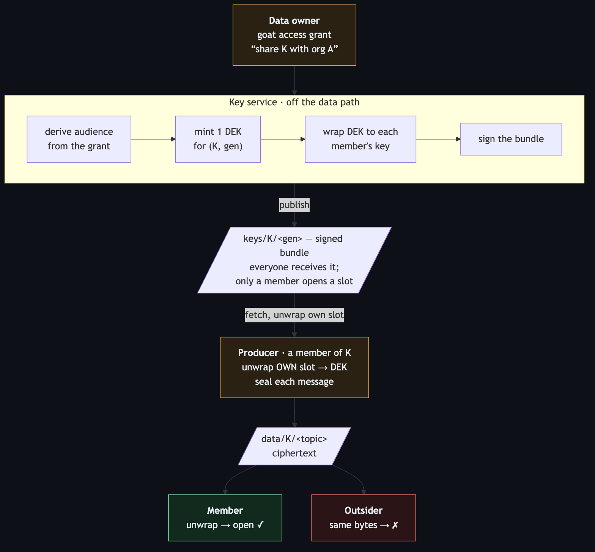

# Hello Galaxy — grant-keyed encryption

**Data-access control that travels *with the data*, on a brokerless fabric, with nothing in the read path that can decrypt.**

This is a teaching walkthrough. You read it, follow it, and run the proof at the end of each step. It answers one question completely:

> On a peer-to-peer mesh where any enrolled node can subscribe to any topic, how does a **data owner** restrict a stream to just the people allowed to read it — without a broker, without a decryptor in the middle, and without a platform admin doing it for them?

The answer is **supplemental encryption bound to grants**: encrypt each stream once to a symmetric key, wrap that key to each authorized member, publish the wrapped bundle as ordinary pub/sub, and let *key possession* be the read check. Take access away by changing the key. It is the machine-plane half of the same access decision people see in their apps — governed by the *same* grants.

This repo is self-contained. The crypto is a readable reference implementation you can study top to bottom (`lib/grant_enc.py`, ~250 lines); the scenarios wire it into the real system shape; an HTML report visualizes it. Nothing here needs a goatnet, and the default path needs no infrastructure at all.

**The scenarios also run on the real thing.** Run [`bin/fetch-sdk.sh`](bin/fetch-sdk.sh) and the endpoint crypto — the producer's seal and the consumer's verify/admit/open — switches from the reference onto the **production grant-crypto SDK** (the audited Rust core behind a versioned C ABI; [ADR 1106](https://github.com/usareur-af/goatcore/blob/main/docs/adr/1106-grant-crypto-sdk-and-endpoint-forward-secrecy.md)), the exact library production producers and consumers use. The reference stays as the readable teaching artifact, and the two are proven **wire-compatible** (bytes sealed by one open under the other). Without the SDK, a bare clone still runs top to bottom on the reference. See [Running on the production SDK](#running-on-the-production-sdk).

**And there's an operator view.** The same flows run from the `goat` CLI — `goat pub --sealed` / `goat sub --open` / `goat access …` — a thin **convenience layer over that same SDK** (it holds no crypto of its own; ADR 1106). That path needs a live goatnet, so it's documented as an annotated transcript rather than run here. See [The goat CLI way](#the-goat-cli-way).

---

## What runs where

| Path | Needs | What it exercises |
|---|---|---|
| `./bin/grant-enc all` | Python 3 + `cryptography` | every scenario on the readable reference, in-process |
| `./bin/grant-enc 03 --fabric` | Docker + `eclipse-zenoh` | scenario 03's bytes over a local Zenoh router |
| `./bin/fetch-sdk.sh` then `./bin/grant-enc all` | Rust ≥ 1.77 + git | the endpoint crypto on the production grant-crypto SDK, built from [`goatcore`](https://github.com/usareur-af/goatcore) |
| [`docs/goat-cli-path.md`](docs/goat-cli-path.md) | a goatnet | the same flows from the `goat` CLI, against a portal, key service and SPIRE trust root |

The first three run on a laptop and in this repo's CI. The last needs a goatnet you have access to, running the portal, the key service and a SPIRE trust root. That can be
EFDI, the shared sandbox goatnet that partners are onboarded to (if you are onboarded to it); <!-- oss-allow: operator-approved public example goatnet -->
a goatlite you stand up yourself on a single box ([`docs/tutorials/00-goatlite.md`](https://github.com/usareur-af/goatcore/blob/main/docs/tutorials/00-goatlite.md) in goatcore); or another goatnet you have access to.

---

## The apparatus at a glance

<!-- Rendered from report/figures/apparatus.mmd — regenerate with:
     mmdc -i report/figures/apparatus.mmd -o report/figures/apparatus.png -b '#0d1117' -->


The read cut is the crypto, not the router: the fabric hands the outsider the identical bytes, and the outsider still cannot open them.

Five moving parts, each demonstrated by one scenario:

1. **The envelope** — one data key seals the stream once; it's wrapped to each member. *(scenario 01)*
2. **The audience** — comes from the owner's grant, derived, never a hand-kept list. *(scenario 02)*
3. **Read and deny** — a member opens the stream; an outsider gets the same bytes and can't. *(scenario 03)*
4. **Revocation is rotation** — remove a member by minting the next generation without it. *(scenario 04)*
5. **Per-individual keys** — why the key is per person/machine and the org is only the grouping. *(scenario 05)*

---

## Anatomy — what you need, and where each piece lives

Grant encryption is a handful of parts cooperating. Some **run as services in the private mesh** — somebody operates them and you just talk to them. Others **you hold or do yourself**, at your own point of action. Knowing which is which is how you get your bearings: it tells you what you're responsible for and what to go read up on.

The short version: **you** bring an identity + keys, and you make a grant. The **mesh services** turn that grant into a key bundle on the fabric. Your own producer/consumer code does the sealing and opening. That's the whole split.

### You hold this / you do this (your point of action)

**Your identity + keypair** — a certificate and a private key **only you hold**; it *is* your member id and the key you unwrap data keys with. The mesh mints the cert at onboarding, but the private key never leaves you. (The *public* cert is also published to the portal's recipient-cert store at mint, which is how the key service can wrap data keys to you with no manual step — see [`docs/data-owner-controls.md`](docs/data-owner-controls.md).)
- *Looks like:* a `.cbor` enrollment bundle → `~/.goat/contexts/<net>/mtls.cert.pem` + `mtls.key.pem` (plus a `portal.token`)
- *In this repo:* `grant_enc.Identity` &nbsp;·&nbsp; *learn:* the goatnet's onboarding ([`hello-galaxy-human-machine-onboarding`](https://github.com/usareur-af/hello-galaxy-human-machine-onboarding)), SPIFFE/SVID

**The grant** *(the decision)* — as your org's **data-governance admin**, you record "share producer K with org A." One line; the platform records it, it doesn't second-guess it.
- *Looks like:* `goat access grant <producer> <org>` — the `goat` CLI calling the portal
- *In this repo:* `demo.Grant` rows &nbsp;·&nbsp; *learn:* [`docs/data-owner-controls.md`](docs/data-owner-controls.md)

**Encrypt / decrypt** — the client-side crypto that seals a message and opens one; it runs **in your own process** (a producer or consumer), never on a server.
- *Looks like:* the **grant-crypto SDK** — the audited Rust core behind a versioned C ABI, with thin Go / Python / TS bindings ([ADR 1106](https://github.com/usareur-af/goatcore/blob/main/docs/adr/1106-grant-crypto-sdk-and-endpoint-forward-secrecy.md); source in goatcore at `ops/grant-crypto/sdk/`)
- *In this repo:* [`lib/grant_enc.py`](lib/grant_enc.py) is the readable reference; run [`bin/fetch-sdk.sh`](bin/fetch-sdk.sh) and the scenarios seal/open on the **real SDK** instead &nbsp;·&nbsp; *learn:* [`docs/envelope-and-keys.md`](docs/envelope-and-keys.md)

**The `goat` CLI** — the one tool to enroll, grant/revoke, and publish/subscribe; you download the build for the goatnet you are using.
- *In this repo:* the demo calls the crypto library directly (the reference, or the SDK once fetched), so you can read every step.

### Runs in the private mesh, at a service location (you just use it)

**The portal** — the HTTP "brain": holds the grant records, derives the audience from them, and mints your cert.
- *Called / where:* `goat-zenoh-portal` at `https://portal.<site>.<zone>` (mesh-internal)
- *Does for you:* answers `goat access grant`; serves `GET /api/access/audience?release_set=<K>` &nbsp;·&nbsp; *in this repo:* `demo.derive_audience` + `demo.Roster`

**The key service** — the daemon that turns grants into keys, so no publisher has to.
- *Called / where:* `grant-keyd`, a per-site daemon on the management host
- *Does for you:* mints the DEK, wraps it to each member's key, **signs** the bundle, publishes `keys/<rs>/<gen>` &nbsp;·&nbsp; *in this repo:* `demo.KeyService`

**The fabric** — the brokerless pub/sub transport everything rides.
- *Called / where:* a **Zenoh** router at `tls/<host>:7447` (mesh-internal)
- *Does for you:* carries the key bundle and your ciphertext; routes bytes it cannot read &nbsp;·&nbsp; *in this repo:* `demo.InProcessBus` (or a real router via `--fabric`)

**The trust root** — the identity authority that vouches a member's key is really theirs.
- *Called / where:* **SPIRE** (issues + validates SVIDs)
- *Does for you:* the key service validates each member against it before wrapping; anchors bundle authenticity &nbsp;·&nbsp; *in this repo:* represented — see the honesty matrix

**Getting your bearings.** If you're a *data owner*, your whole job is two things you already have tools for: hold your enrollment identity, and run `goat access grant`. If you're a *producer or consumer*, you run the encrypt/decrypt library in your process and let the fabric hand you the key bundle. Everything in the second group is somebody else's service that you simply talk to. The things worth reading next, in order: [the envelope + keys](docs/envelope-and-keys.md) (the crypto you run), [who decides](docs/data-owner-controls.md) (the grant + the roles), and your goatnet's **onboarding** (how you get the identity in the first place).

---

## Three ways through it — pick how you like to learn

Same walkthrough, three depths. **Reach for the script last, not first:** if a script does the thing *for* you, you can run it green and still not know what happened. The point here is to learn the apparatus, so the reading paths come first.

**1. Markdown walkthrough** — best for getting the *why* before the *how*, at your own pace.
Read [`docs/envelope-and-keys.md`](docs/envelope-and-keys.md) → [`docs/data-owner-controls.md`](docs/data-owner-controls.md), then each [`scenarios/NN/README.md`](scenarios/) recipe. No setup needed.

**2. Jupyter notebook** — best for *doing* it hands-on, one idea per cell, editing as you go.
Open [`notebooks/walkthrough.ipynb`](notebooks/walkthrough.ipynb) and run it cell by cell — each markdown cell explains, the next code cell does exactly that step. (Jupyter is polyglot; this notebook is Python because the reference library is, but a deployment walkthrough could use a shell kernel for the `goat` CLI steps.)

**3. Script** — best for proving it's real, or a fast regression check.
`./bin/grant-enc all` runs the whole thing and asserts each result. Use it *after* the reading, to confirm what you learned actually holds.

---

## Quickstart

Needs Python 3 and the `cryptography` package. On Debian/Ubuntu the system pip
refuses to install into the OS Python (PEP 668), so use a venv:
`python3 -m venv .venv && . .venv/bin/activate && pip install cryptography`.
Nothing else for the default path.

```bash
./bin/grant-enc list        # the six scenarios
./bin/grant-enc all         # run the whole walkthrough
./bin/grant-enc 03          # run one (by number, name, or suffix)
```

Each scenario prints a numbered walkthrough and ends in a `PASS`/`FAIL` line — the proof. **Read the scenario's `README.md` first**; the script is the companion that shows it's real, not the lesson itself.

Want it on a real router? Scenario 03 takes `--fabric` to carry the *identical bytes* over a live `eclipse/zenoh:1.9.0` router — see [`local-fabric/README.md`](local-fabric/README.md).

---

## Running on the production SDK

By default the scenarios run on the readable reference (`lib/grant_enc.py`). To run the endpoint crypto on the **actual production library** — the grant-crypto SDK — fetch it once:

```bash
./bin/fetch-sdk.sh                         # sparse-clone goatcore and build the SDK from it
./bin/fetch-sdk.sh --local /path/to/goatcore   # use a goatcore checkout you already have
```

That lands the SDK under `./sdk/` (gitignored), checks your Rust toolchain (needs **≥ 1.77**), and builds the C ABI cdylib (`cargo build -p grant-crypto-capi`). The Python binding is pure stdlib — no pip step. Then:

```bash
./bin/grant-enc all          # scenarios now seal/open on the SDK
python3 tests/cross_compat.py  # prove grant_enc <-> SDK wire compatibility, both directions
```

You'll see `endpoint crypto backend: grant-crypto SDK` in the narration. What changed and why:

- **The producer and consumer** (`demo.Producer` / `demo.Consumer`, used by scenarios 03–05, and the notebook) now seal with `StreamKey.acquire(...).seal(...)` and read with `verify_bundle` + `KeyStore.admit/open` — the SDK's misuse-resistant surface (no nonce, no algorithm, no recipients at the call site).
- **The key service stays on `grant_enc`** — it mirrors the real `grant-keyd` daemon, and the SDK deliberately has no key-authority surface (a producer is not a key authority). So even in SDK mode, the bundle the SDK verifies and opens was minted and signed by the reference — a reference→SDK interop crossing on every run.
- **`lib/grant_enc.py` stays** as the labeled teaching reference ([ADR 1106](https://github.com/usareur-af/goatcore/blob/main/docs/adr/1106-grant-crypto-sdk-and-endpoint-forward-secrecy.md)), and is the fallback when the SDK isn't fetched, so a bare clone still runs.

---

## The goat CLI way

There is a third view of the same mechanism: the **`goat` CLI**, the operator's one binary. Instead of writing a producer/consumer against the library, an operator with a shell drives the identical flows directly:

```bash
goat pub  acme-sensors/obs/v1   --sealed --key-service-bundle spire-root.pem --trust-domain <td> < event.pb
goat sub 'acme-sensors/obs/**' --open   --key-service-bundle spire-root.pem --trust-domain <td>
goat access grant acme-sensors northwind        # the decision
goat access audience acme-sensors            # who can read it — derived, not hand-kept
```

This is a **convenience path, not a fourth implementation.** goat-cli holds no crypto of its own — `--sealed`/`--open` delegate straight to the same grant-crypto SDK the scenarios run on (ADR 1106) — so a byte sealed by the reference, by a Rust producer on the SDK, or by `goat pub --sealed` is the same byte, openable by any of the three. That completes the through-line: **readable reference → production SDK → goat CLI = three views of one wire-compatible mechanism.**

Unlike the reference (zero infrastructure) and the SDK path (a toolchain + a download), the `goat` path needs a **live goatnet** — an enrolled profile, a reachable key service and portal, a SPIRE trust root — none of which a bare clone or this repo's CI has. So it is documented as an **annotated transcript, not run here**, mapping each scenario's crypto moment to its `goat` command. Honesty over a fake green check.

**→ [`docs/goat-cli-path.md`](docs/goat-cli-path.md)** — the full walkthrough, scenario by scenario.

---

## Read in this order

| # | Path | What it gives you |
|---|------|-------------------|
| — | [`docs/envelope-and-keys.md`](docs/envelope-and-keys.md) | **The one mechanism.** Understand this and the rest is obvious: DEK, envelope, wrap, signed bundle. |
| — | [`docs/data-owner-controls.md`](docs/data-owner-controls.md) | Who decides: organizations own sharing; a data-governance admin acts; keys are per-individual. |
| 01–06 | [`scenarios/`](scenarios/) | The walkthrough — one recipe per moving part. |
| — | [`docs/goat-cli-path.md`](docs/goat-cli-path.md) | **The operator view.** The same scenarios as `goat pub --sealed` / `sub --open` / `access …` — the convenience path over the same SDK. |
| — | [`docs/honesty-matrix.md`](docs/honesty-matrix.md) | **Every claim graded** live-vs-represented. What this repo really proves, and what it stands in for. |
| — | [`docs/the-philosophy.md`](docs/the-philosophy.md) | Why the shape is what it is — brokerless, owner-controlled, audit-accountable. |
| — | [`report/report.html`](report/report.html) | The visual capstone: figures + the end-to-end flow, in one page. |

---

## The honest boundary

This mechanism reaches **topic (release-set) granularity — one whole stream — and no finer.** It cannot do per-field or per-row machine access, because that would need a component that holds plaintext in the read path: the very broker a mesh exists to avoid. Field/row control belongs on the *human plane* (apps that check permissions per request against the same grants). Two planes, **one set of grants** — never a second store of rules.

And it is **coarse-but-brokerless by choice**: the network keeps routing ciphertext it cannot read, so a site cut off from everything keeps working. See the honesty matrix for exactly what each scenario proves versus models.

---

*Part of the Hello Galaxy series — self-contained, runnable, best-practice demonstrations of how the goat fabric works. The design lives in [`goatcore`](https://github.com/usareur-af/goatcore): grant-keyed encryption ([ADR 1094](https://github.com/usareur-af/goatcore/blob/main/docs/adr/1094-grant-keyed-payload-encryption.md), [ADR 1102](https://github.com/usareur-af/goatcore/blob/main/docs/adr/1102-organization-owned-data-sharing.md)) and the grant-crypto SDK ([ADR 1106](https://github.com/usareur-af/goatcore/blob/main/docs/adr/1106-grant-crypto-sdk-and-endpoint-forward-secrecy.md), [`grant-crypto-sdk.md`](https://github.com/usareur-af/goatcore/blob/main/docs/design/grant-crypto-sdk.md)); this repo is the shown-not-told companion.*

## Licence

`hello-galaxy-grant-encryption` was written by U.S. Federal government employees. In the U.S. it is not subject to copyright and is in the public domain; in countries where copyright is recognized, it is released under the [Apache License 2.0](LICENSE). See [INTENT.md](INTENT.md).
